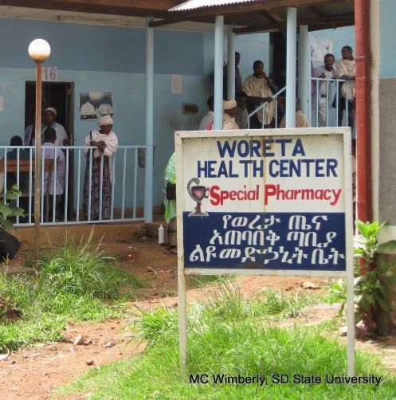
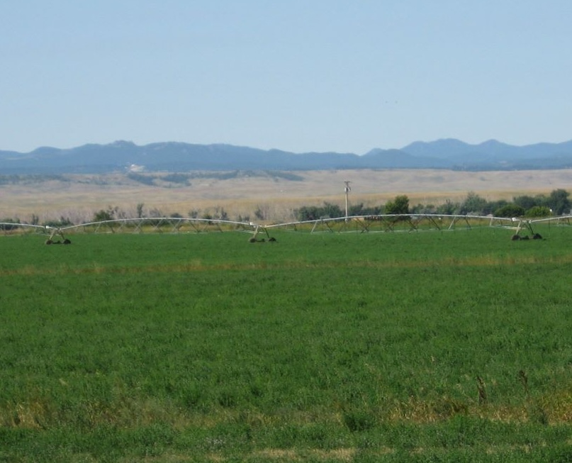
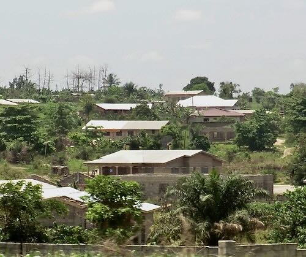

::: {.home-section}

What we study

## From landscapes to global change

Welcome to the EcoGRAPH research group in the Department of [Geography and Environmental Sustainability](http://www.ou.edu/ags/geography) at the [University of Oklahoma](http://www.ou.edu/)! We investigate how changing climate and landscapes affect ecosystems and human health, combining satellite Earth observations, environmental monitoring, and geospatial modeling to understand and predict these impacts. Working with a global network of collaborators, we translate our results into actionable information for public health, land-use planning, and natural resource management. Our work spans landscape to global scales, addressing topics such as climate-sensitive infectious diseases, forest degradation and wildfire, agricultural and urban expansion, and the ecological impacts of environmental change. Explore the examples below or visit our [Research](research.html) and [Products](software.html) pages to learn more.

::: {.theme-grid}
<a class="theme-card" href="research/malaria_forecasting.html">

<h3>Malaria Early Warning</h3>

Forecasts and outbreak detection in Ethiopia

</a>
<a class="theme-card" href="research/wnv_forecasting.html">

<h3>West Nile Virus Forecasting</h3>

Outbreak forecasts for the United States

</a>
<a class="theme-card" href="research/urban_expansion.html">

<h3>Urban Expansion Dynamics</h3>

Drivers and impacts of urban growth

</a>
<a class="theme-card" href="research/tropical_forest.html">

<h3>Forests and wildfire</h3>

Degradation, disturbance, and fire

</a>
:::
:::

::: {.home-section}

Explore

## Around the group

::: {.explore-grid}
<a class="explore-card" href="people.html">PeopleResearchers in the EcoGRAPH group</a>
<a class="explore-card" href="research.html">ResearchClimate, disease, fire, and land change</a>
<a class="explore-card" href="software.html">ProductsForecasting and monitoring tools</a>
<a class="explore-card" href="publications.html">PublicationsPapers from the research group</a>
:::
:::

::: {.hiring-callout}
We are hiring!

The EcoGRAPH group has an opening for a postdoctoral associate to work on a new NASA project focused on predicting mosquito-borne disease outbreaks in the United States. We will begin evaluating applications on December 1, 2026. Follow [this link](https://ecograph.net/documents/NASA_ArboMAP_Postdoc_05NOV2026.pdf) for the full job announcement.
:::
