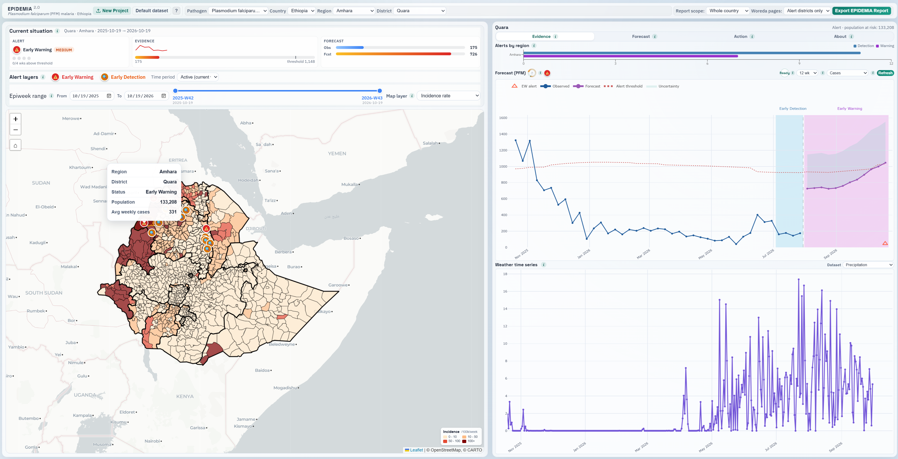

## Project Description

In Ethiopia, confirmed malaria cases have increased approximately threefold since 2019, highlighting the need for improved disease surveillance, outbreak forecasting, and proactive public health interventions. Climate variability, conflict, population displacement, and drug and insecticide resistance contribute to the changing malaria landscape.

The Epidemic Prognosis Incorporating Disease and Environmental Monitoring for Integrated Assessment (EPIDEMIA) system was co-developed by U.S. and Ethiopian scientists and public health professionals to integrate epidemiological surveillance data with NASA Earth observations and environmental datasets for outbreak detection and forecasting. Building on the original system, **EPIDEMIA 2.0** aims to deliver a next-generation, interactive, and scalable epidemic intelligence platform.

The project focuses on improving forecasting capabilities, expanding environmental data integration, and providing interactive visual analytics to help public health professionals explore disease trends, identify elevated-risk areas, and support evidence-based decisions.

The project has four primary objectives:

1. **Enhance interactive visualization:** Develop a user-friendly interface for exploring epidemiological, environmental, and forecasting results.
2. **Expand environmental data integration:** Incorporate additional satellite-derived observations, including precipitation, land surface temperature, and vegetation indices.
3. **Improve outbreak detection and forecasting:** Integrate multiple statistical and computational approaches to detect unusual disease activity and predict future outbreaks.
4. **Strengthen decision support and scalability:** Improve district-level analysis and develop an extensible framework for additional climate-sensitive diseases.

Through continued collaboration with the Ethiopian Public Health Institute (EPHI) and other stakeholders, EPIDEMIA 2.0 aims to strengthen epidemic preparedness and surveillance across Ethiopia by translating complex epidemiological and environmental data into accessible, interpretable, and actionable information.

## Dashboard

The [EPIDEMIA 2.0 dashboard](https://epidemia-ui.disc.ourcloud.ou.edu/) provides interactive maps and charts of malaria surveillance, forecasts, and environmental conditions for districts in Ethiopia.

  *Screenshot of the EPIDEMIA 2.0 dashboard for Quara district, Amhara, showing malaria alerts, incidence forecasts, and precipitation.*

## Partner Organizations

- [Amhara Public Health Institute](https://aphi.gov.et/)
- [Bahir Dar University](http://www.bdu.edu.et/)
- [Ethiopian Public Health Institute](https://www.ephi.gov.et/)
- [Health, Development, and Anti-Malaria Association](http://www.hdama.org/)

## Funding

- NIAID (R01AI079411)
- USAID (AID-OAA-TO-14-00044 SUB-778)
- NASA (80NSSC25K0352)
